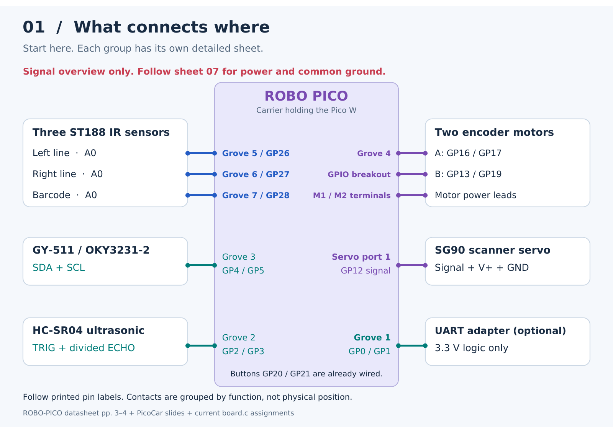
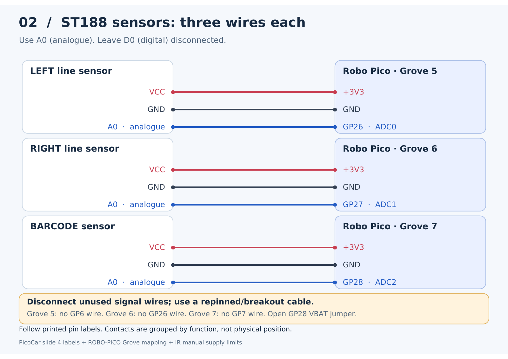
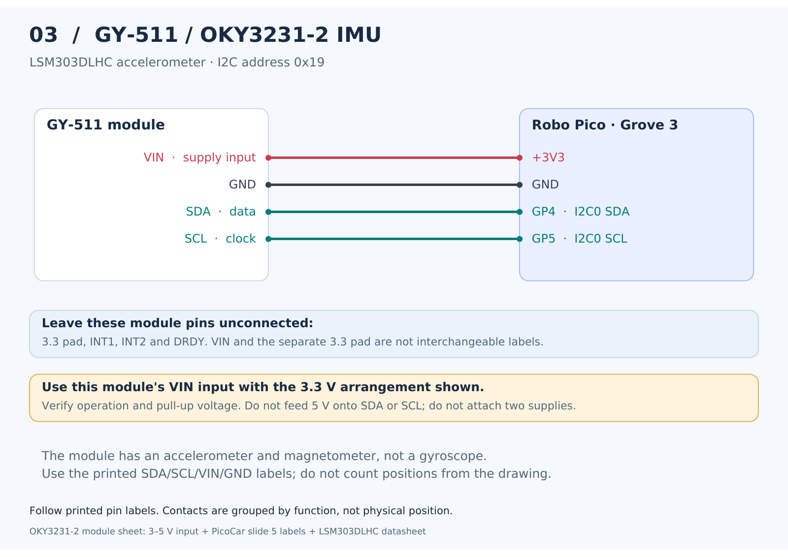
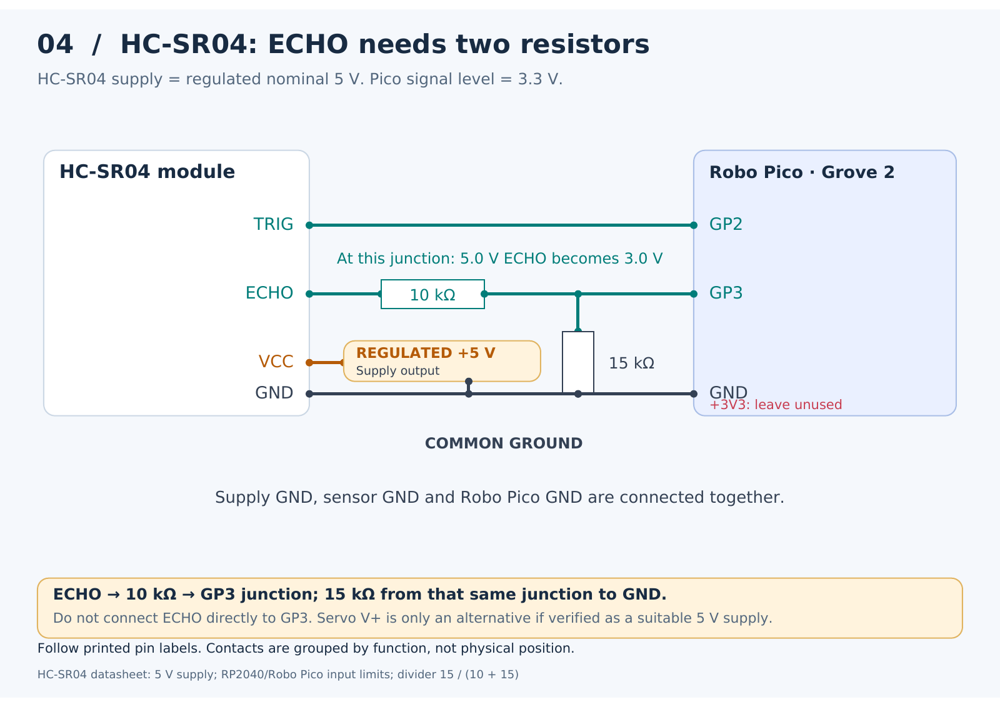
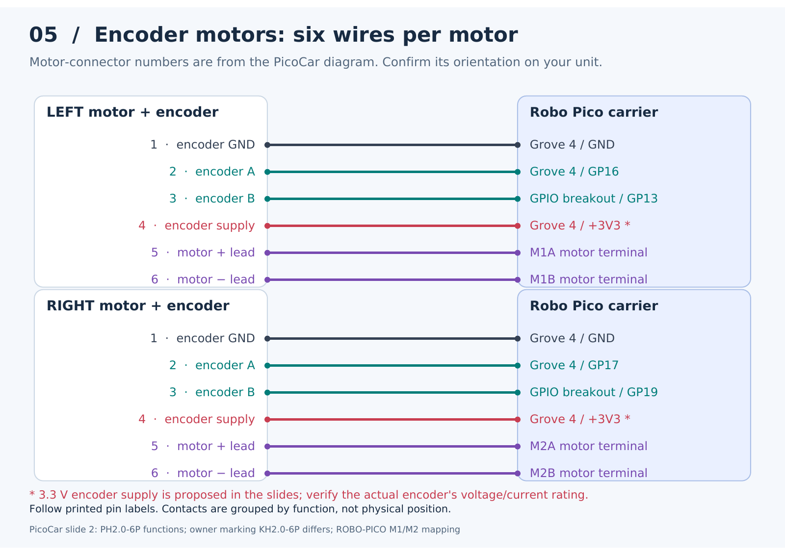
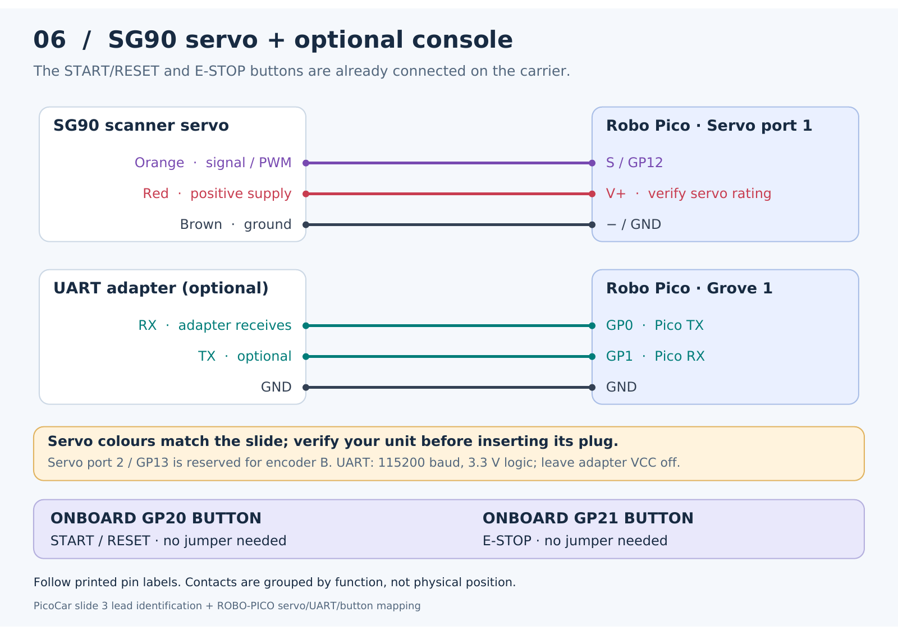
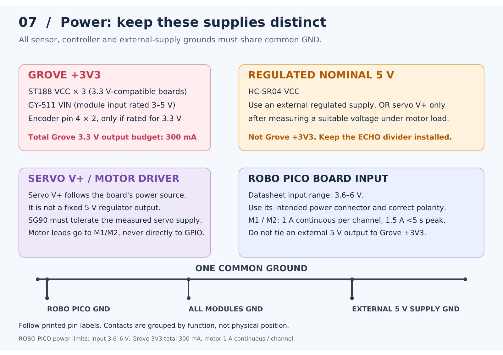
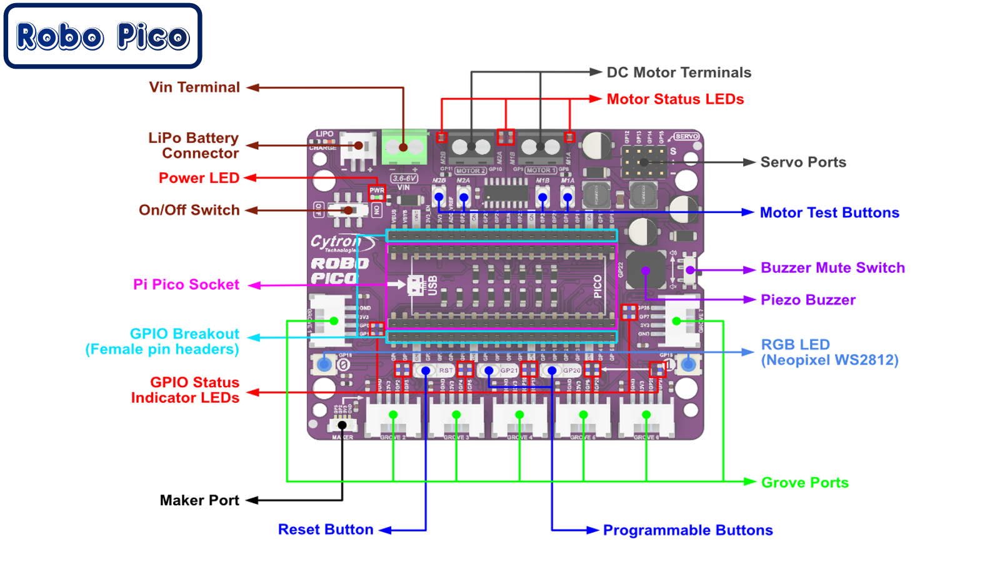

# Visual wiring guide: Pico W + Robo Pico

Start with the overview, then wire **one module at a time** using its own diagram.
Every wire is labelled at both ends. Click an image for a larger view.

**[Open the seven-page PDF](wiring/WIRING.pdf)** ·
[Overview](#1-overview) · [IR sensors](#2-three-st188-ir-sensors) ·
[IMU](#3-gy-511-imu) · [Ultrasonic](#4-hc-sr04-ultrasonic) ·
[Motors](#5-two-encoder-motors) · [Servo and console](#6-sg90-servo-and-optional-console) ·
[Power](#7-power-and-common-ground)

The Grove sockets, servo ports, motor terminals and GPIO breakout headers are
on the **Robo Pico carrier board**. The smaller **Pico W plugs into that carrier**.
GP labels identify signals, such as GP26; no Pico position numbers are needed.

These are **connection diagrams**, not drawings of physical pin order. Match
printed labels on the module and carrier. Use a correctly repinned harness or
breakout cable: a four-pin module does not automatically match a four-pin Grove
socket. Power off while wiring.

## 1. Overview

This overview groups signal connections. Each detailed sheet below includes
its power and ground wires. Follow the power sheet before applying power.

## 2. Three ST188 IR sensors

Use **A0** (A-zero, analogue output; sometimes labelled AO or AOUT), not **D0**.
Leave D0 disconnected on each board. The firmware reads analogue values.
The owner identifies ST188 sensors; the board photo in PicoCar slide 4 shows
VCC/GND/D0/A0. The older Waveshare manual has a different numbered layout, so
use your actual board's printed labels.

**GP26 appears on both Grove 5 and Grove 6.** Connect only the left sensor to it
through Grove 5. Leave Grove 6's GP26 wire unused; the right sensor uses GP27.
Open the **GP28 VBAT-sense solder jumper** before connecting the barcode sensor.
Use 3.3 V-compatible IR boards and verify their analogue outputs stay at 0–3.3 V.

## 3. GY-511 IMU

The supplied **OKY3231-2 / GY-511** sheet identifies an **LSM303DLHC** and a
3–5 V module input range. The diagram uses VIN supplied from Grove 3 +3V3;
verify operation at that voltage and that SDA/SCL pull-ups stay at 3.3 V.
Leave the separate module **3.3 pad**, INT1, INT2 and DRDY unused in this arrangement.
Do not attach two supply sources. Firmware expects accelerometer address 0x19
and mounting X forward / Y left / Z up. LSM303D and MPU-6050 are not drop-in replacements.

## 4. HC-SR04 ultrasonic

The **10 kΩ resistor goes between ECHO and the GP3 junction**. The **15 kΩ
resistor goes from that same junction to GND**. That produces 3.0 V from a
5.0 V ECHO, or 3.3 V from 5.5 V. Measure the divider before attaching GP3.

The supplied HC-SR04 datasheet specifies **nominal 5 V**, despite the 3.3 V
annotation in PicoCar slide 4. Use a regulated 5 V supply and common ground.
Servo-port V+ is an alternative only after verifying suitable voltage under load;
it is not a fixed 5 V output. Leave Grove 2 +3V3 unused for the HC-SR04.
Verify the fitted module accepts the Pico's 3.3 V TRIG signal. Use local decoupling
and keep the signal wires away from motor leads. The Maker Port shares GP2/GP3;
leave it unused while those signals serve the ultrasonic module.

## 5. Two encoder motors

These numbers belong to the **motor connector**, not the Pico. PicoCar slide 2
assigns: 1 encoder GND, 2 A, 3 B, 4 encoder supply, 5 motor +, 6 motor −.
The owner marking is **KH2.0-6P**, while that diagram says **PH2.0-6P**. Match
the actual connector and orientation to the [original motor diagram](recovered-context/picocar/motor-pinout.png)
before applying power; looking into the mating plug can reverse the apparent order.

The slides propose 3.3 V for encoder pin 4; the motor model and encoder voltage/current
rating remain unverified. Confirm them before connecting that supply. If encoder
logic requires 5 V, use a suitable logic interface; never feed a 5 V push-pull
encoder output directly to a GP input.

Grove 4 needs a **split harness** for left A and right A. The B wires use the
**Robo Pico GPIO breakout header**, GP13 and GP19. GP13 is also accessible at
servo port 2's signal contact; that is the same signal, not an extra allocation.
Do not plug a second servo into port 2.

Motor leads go to **M1A/M1B** and **M2A/M2B**, never to GPIO or Grove power.
Both are switched driver outputs: the motor's minus lead is not tied to GND.
GP8/GP9 already control M1 internally, and GP10/GP11 already control M2.
Verify forward direction and encoder signs during calibration with wheels raised.

## 6. SG90 servo and optional console

The SG90 lead colours come from PicoCar slide 3; verify your unit matches and
connect its plug to servo port 1 by **S / V+ / GND**. Confirm the fitted servo's
supply rating and stall current. Firmware uses 50 Hz, 1000–2000 µs pulses as a
starting range; check travel before loading the mechanism.

The optional UART adapter must use **3.3 V logic**, not RS-232 voltages.
Connect GND, adapter RX to GP0 and optional adapter TX to GP1. Leave its power
output disconnected when the Robo Pico has its own supply. Use 115200 baud.
The onboard GP20 and GP21 buttons need no new wiring.

## 7. Power and common ground

The carrier's input range is **3.6–6 V**, but attached modules must tolerate the
actual supply they receive. Motor/servo power follows the board input source;
verify it under load. Respect the board's **300 mA total Grove +3V3 output** and
**1 A continuous / 1.5 A short peak per motor channel**. Size the supply for
motor stall and servo current. Share ground with any external regulated sensor
supply without joining its +5 V output to Grove +3V3 or back-feeding other rails.

Battery-voltage sensing is unavailable while GP28 reads the barcode sensor.
Use suitable battery protection and an accessible independent power switch.
Physical supply, polarity and harness checks remain necessary. Firmware still
inhibits motors until measured calibration is completed; see [README.md](../README.md).

## Find the connectors on the real carrier

The photo identifies the **GPIO breakout female headers** alongside the Pico
socket. Use the GP13/GP19 contacts there; no soldering directly to the Pico W
is required. The picture's Pico 2 compatibility label does not change this
firmware's Pico W / RP2040 target.

GP6, GP7, GP14 and GP15 are unused by this wiring. GP18's RGB LED and GP22's
buzzer are not driven. GP23/24/25/29 are reserved for Pico W radio functions;
do not use them for these modules.

## Sources and editable diagrams

The newly uploaded Datasheets.zip matches the earlier package byte-for-byte
(SHA-256 `f30d0ceed4dfe87b305ea5c32b8ee45f26d03311df91b51a5fbcf707e045cd30`).

- [ROBO-PICO datasheet, pages 3–4](recovered-context/reference-text/Robo_Pico.txt): carrier connectors, GPIO mapping and power limits.
- [HC-SR04 datasheet](recovered-context/reference-text/HCSR04.txt): supply, signals and ranging timing.
- [OKY3231-2 sheet](recovered-context/reference-text/OKY3231-2.txt) and [LSM303DLHC datasheet](recovered-context/reference-text/lsm303dlhc.txt): module identity, supply and sensor configuration.
- [IR sensor manual](recovered-context/reference-text/Infrared-Reflective-Sensor-UserManual.txt): analogue versus digital outputs and module supply limits; its numbered pin order does not identify every ST188 carrier board.
- [PicoCar slides](recovered-context/picocar/PicoCar.pptx): actual reference photographs, motor connector functions and servo lead identification.
- [Current board adapter](../app_program/subsystem2/board.c): firmware signal assignments.

[SVG originals and PNG sheets](wiring) are saved alongside the PDF. Regenerate
with `python3 tools/draw_wiring.py` from the repository root (requires ReportLab,
DejaVu Sans fonts and Poppler's pdftoppm). This update changes documentation only.
