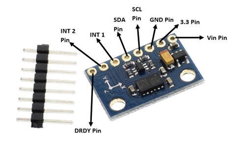
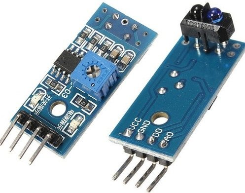
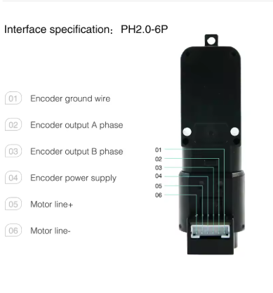

# Wiring: Pico W + Cytron Robo Pico

Power off before wiring. **GP means the signal label**, for example GP26.
Use that label on the board or connector; there is no Pico position-number
column in this guide. **Grove** is the connector name printed on the Robo Pico.
The Robo Pico is the carrier board holding the smaller Raspberry Pi Pico W.

The tables below specify a wiring arrangement matching the existing firmware.
Grove connections require a breakout cable or correctly repinned harness where
the module has a different connector. Locate each contact by the Robo Pico
pinout/silkscreen and continuity-check it with power off. **Do not match cable
colours or assume the module's pin order matches a Grove socket.**

## Module identification: supplied files and owner confirmation

| Device | Model / module number | Identification limit |
| --- | --- | --- |
| Controller | Raspberry Pi Pico W + Cytron **ROBO-PICO** | These tables use the supplied ROBO-PICO datasheet. |
| Ultrasonic distance module | **HC-SR04**, nominal 5 V | Not HC-SR04P. Use its labelled VCC, TRIG, ECHO, GND pins. |
| IMU module | **OKY3231-2 / GY-511**, containing **LSM303DLHC** | OKY3231-2 is the product module number in the supplied sheet. Check the installed board matches. |
| Three IR sensors: left line, right line, barcode | **ST188**, confirmed by owner | PicoCar slide 4 shows a board labelled **VCC, GND, D0, A0**. Use those labels; the older Waveshare manual has a different numbered layout. |
| Scanner servo | **SG90**, confirmed by owner | The exact manufacturer's sheet, supply rating, stall current and connector orientation are still needed for the fitted unit. |
| Left and right encoder gearmotors | Owner-provided marking: **KH2.0-6P**; slide diagram: **PH2.0-6P** | PicoCar slide 2 supplies pin functions 1–6, mapped below. The two connector markings differ; match the pictured connector/orientation to the actual unit. Exact motor model and voltage/current ratings remain unverified. |
| Optional UART adapter | Model **unconfirmed**; must use 3.3 V logic | Use labelled RX, TX and GND. |

The tables use **module pin labels**, with numbered motor contacts from the
newly supplied slide diagram. The IR board in PicoCar slide 4 is labelled
**VCC, GND, D0, A0**. Do not transfer the older Waveshare manual's numbered
pinout to this board: that manual lists **1 DOUT, 2 AOUT, 3 GND, 4 VCC**.
Use the labels on the actual board rather than counting pins from a photo.

Owner confirmation received on 30 October 2026: **IR Sen: ST188; Servo: SG90;
Enc Motor: KH2.0-6P**. The subsequently supplied **PicoCar.pptx** provides the
motor pin-function diagram and module photos used in this revision. These
are reference diagrams, not measurements of the installed hardware.

## Where each connection is on the Robo Pico

All seven Grove sockets below are on the **Robo Pico carrier**, not the Pico W
itself. Each also provides +3V3 and GND; these are power contacts, not GPIOs.

| Robo Pico connector | Signal contacts | Use in this wiring arrangement |
| --- | --- | --- |
| Grove 1 | GP0, GP1 | Optional UART adapter |
| Grove 2 | GP2, GP3 | HC-SR04 TRIG and divided ECHO |
| Grove 3 | GP4, GP5 | GY-511 SDA and SCL |
| Grove 4 | GP16, GP17 | Left encoder A and right encoder A, split harness |
| Grove 5 | GP6, GP26 | Left IR analogue output on GP26 only; GP6 left disconnected |
| Grove 6 | GP26, GP27 | Right IR analogue output on GP27 only; this socket's GP26 contact left disconnected |
| Grove 7 | GP7, GP28 | Barcode analogue output on GP28 only; GP7 left disconnected |
| Servo port 1 | Signal GP12, V+, GND | Scanner servo |
| Servo port 2 | Signal GP13, V+, GND | Signal contact used for left encoder B; **not a second servo** |
| Robo Pico GPIO breakout female header | GP19 | Right encoder B; no Grove socket carries GP19 |
| Motor terminals M1 / M2 | Motor power outputs | Left / right motor leads; not sensor or GPIO sockets |
| Onboard buttons | GP20, GP21 | START/RESET and E-STOP; already wired on carrier |

**Grove 5 GP26 and Grove 6 GP26 are the same electrical signal.** They cannot
receive two independent sensor outputs. Use the individual contacts specified
below and leave unused signal wires disconnected at the module end. A sensor's
digital output must not accidentally connect to another sensor's analogue line.
The Maker Port shares GP2/GP3 with Grove 2; do not attach another device there
while these signals are used for the HC-SR04.

GP19 is on the **Robo Pico carrier's GPIO breakout female header**, outside
the Grove system. PicoCar slide 7 labels these header rows “GPIO Breakout
(Female pin headers)”. Use the **GP19-labelled contact** verified against the
board pinout; you do not need to solder to the smaller Pico W board. The same
breakout also exposes GP13 if that is more convenient than servo port 2's signal
contact; these are two access points to the same GP13 signal, not separate pins
you can allocate independently.


## Module pin → GP signal → board connector

### HC-SR04 ultrasonic module

| Module pin | GP / power destination | Where to connect | Wiring detail |
| --- | --- | --- | --- |
| TRIG | GP2 | Robo Pico **Grove 2**, GP2 signal contact | Direct signal connection. |
| ECHO | GP3, through divider | Robo Pico **Grove 2**, GP3 signal contact | Connect ECHO through 10 kΩ to GP3; connect 15 kΩ from GP3 to GND. See diagram below. |
| VCC | Verified regulated nominal 5 V | Separate 5 V supply; alternatively Robo Pico **servo port 2 V+** only if verified suitable under load | **Do not use Grove +3V3** for this 5 V module. Servo V+ is not a fixed 5 V regulator output. |
| GND | GND | Robo Pico Grove 2 GND / common ground | Also connect the 5 V supply ground if using an external supply. |

Only the two HC-SR04 signals and ground use Grove 2. Its +3V3 contact is unused
for this module. Servo port 2's signal remains reserved for encoder B, even if
its power contacts supply the ultrasonic module.

### OKY3231-2 / GY-511 LSM303DLHC module

| Module pin label | GP / power destination | Where to connect | Wiring detail |
| --- | --- | --- | --- |
| SDA | GP4 | Robo Pico **Grove 3**, GP4 signal contact | I2C0 data. |
| SCL | GP5 | Robo Pico **Grove 3**, GP5 signal contact | I2C0 clock. |
| VIN, labelled “Vin Pin” in slide 5 | +3V3 | Robo Pico **Grove 3 +3V3** | Module sheet permits 3–5 V input; verify correct operation at 3.3 V and bus pull-ups at 3.3 V. |
| GND | GND | Robo Pico **Grove 3 GND** | Common ground. |
| 3.3, labelled “3.3 Pin” in slide 5 | None in this arrangement | Leave unconnected | Separate from VIN. Do not connect two supply sources or assume this is another VIN; confirm its regulator-rail function from the actual module schematic before using it. |
| INT1, INT2, DRDY | None | Leave unconnected | Firmware polls the accelerometer; it does not use these pins. |



### Three ST188 IR modules: use analogue output

The owner identifies all three IR sensors as ST188. The module photo in
**PicoCar slide 4** labels the four contacts **VCC, GND, D0, A0**. Here **A0**
(A-zero, often called AO/AOUT) is the analogue output; **D0** (D-zero, also
called DO/DOUT) is the comparator's digital output. **Use A0 and leave D0
disconnected on all three modules.** The firmware samples ADC values; the
slide's generic “pick one” advice does not make D0 interchangeable with A0
for this firmware.



| Module / role | Module pin | GP / power destination | Where to connect |
| --- | --- | --- | --- |
| ST188 left line IR | A0 (analogue) | GP26 / ADC0 | Robo Pico **Grove 5**, GP26 signal contact |
| Left line IR | VCC | +3V3, only for a 3.3 V-compatible module | Robo Pico **Grove 5 +3V3** |
| Left line IR | GND | GND | Robo Pico **Grove 5 GND** |
| ST188 right line IR | A0 (analogue) | GP27 / ADC1 | Robo Pico **Grove 6**, GP27 signal contact |
| Right line IR | VCC | +3V3, only for a 3.3 V-compatible module | Robo Pico **Grove 6 +3V3** |
| Right line IR | GND | GND | Robo Pico **Grove 6 GND** |
| ST188 barcode IR | A0 (analogue) | GP28 / ADC2 | Robo Pico **Grove 7**, GP28 signal contact; **open GP28 VBAT sense jumper** |
| Barcode IR | VCC | +3V3, only for a 3.3 V-compatible module | Robo Pico **Grove 7 +3V3** |
| Barcode IR | GND | GND | Robo Pico **Grove 7 GND** |
| All three ST188 IR modules | D0 (digital) | None | Leave disconnected; this firmware reads analogue outputs |

This arrangement uses one analogue signal per sensor. It does **not** connect
a four-pin IR module straight to a four-pin Grove cable: their pin functions
and order must be adapted. Keep GP6 (Grove 5), GP26 (Grove 6) and GP7 (Grove 7)
unused by those modules. GP26 is already driven by the left sensor via Grove 5.

### Left and right encoder motors: six-pin connector

The owner supplied **KH2.0-6P**; the image in **PicoCar slide 2** instead says
**PH2.0-6P**. The diagram specifies the following pin functions, now mapped to
the existing firmware. Confirm the actual connector matches the diagram before
applying power. Numbers refer to the **motor module connector**, not the Pico.
Use the diagram's orientation and traces to identify contact 1; do not assume
the order is the same when looking into the mating cable plug.



| Module / role | Module pin / lead | GP / power destination | Where to connect |
| --- | --- | --- | --- |
| Left motor | **5: motor +** | M1A driver output | Robo Pico **M1A motor terminal**, already controlled by GP8 |
| Left motor | **6: motor −** | M1B driver output | Robo Pico **M1B motor terminal**, already controlled by GP9 |
| Right motor | **5: motor +** | M2A driver output | Robo Pico **M2A motor terminal**, already controlled by GP10 |
| Right motor | **6: motor −** | M2B driver output | Robo Pico **M2B motor terminal**, already controlled by GP11 |
| Left encoder | **2: output A phase** | GP16 | Robo Pico **Grove 4**, GP16 signal contact |
| Right encoder | **2: output A phase** | GP17 | Robo Pico **Grove 4**, GP17 signal contact |
| Left encoder | **3: output B phase** | GP13 | Robo Pico **servo port 2 signal**, or **GPIO breakout GP13**; do not use V+ for this signal |
| Right encoder | **3: output B phase** | GP19 | Robo Pico **GPIO breakout female header GP19**, not Grove |
| Both encoders | **4: encoder power supply** | +3V3 proposed in slide 1 | Robo Pico **Grove 4 +3V3**, subject to confirming actual encoder voltage/current requirements |
| Both encoders | **1: encoder ground** | GND | Robo Pico **Grove 4 GND** / common ground |

Pins 5/6 carry switched motor power; pin 4 supplies only the encoder electronics.
Do not join pin 4 to a motor terminal. M+/M− are lead labels, not instructions
to tie M− to ground: both motor leads go to the driver. Check forward direction
with wheels raised and calibrate motor/encoder signs for the mirrored mounting.

Grove 4 needs a split harness: GP16 goes to the left motor's A pin and GP17 to
the right motor's A pin. Power and ground may be distributed only after checking
both encoders' ratings and the board's current budget. The remaining B wires go
to GP13 and GP19 as above. Do not connect a whole six-wire motor plug to Grove.

The carrier already connects its left motor driver inputs to **GP8/GP9** and
right driver inputs to **GP10/GP11**. Those are internal control connections;
do not run the motor power leads to the Pico GP8–GP11 header pins.

### Scanner servo, onboard buttons and optional UART adapter

| Module / role | Module pin / contact | GP / power destination | Where to connect |
| --- | --- | --- | --- |
| SG90 scanner servo | Signal / PWM, **orange in slide 3** | GP12 | Robo Pico **servo port 1 signal**, marked S |
| SG90 scanner servo | V+, **red in slide 3** | Supply within actual servo rating | Robo Pico **servo port 1 V+**, only if board input voltage meets servo rating |
| SG90 scanner servo | GND, **brown in slide 3** | GND | Robo Pico **servo port 1 GND**, marked − |
| Onboard START/RESET button | Switch signal | GP20 | **Already wired on Robo Pico**; no external jumper |
| Onboard E-STOP button | Switch signal | GP21 | **Already wired on Robo Pico**; no external jumper |
| 3.3 V UART adapter | RX | GP0, Pico console TX | Robo Pico **Grove 1**, GP0 signal contact |
| 3.3 V UART adapter | TX, optional | GP1, Pico console RX | Robo Pico **Grove 1**, GP1 signal contact |
| 3.3 V UART adapter | GND | GND | Robo Pico **Grove 1 GND** |
| 3.3 V UART adapter | VCC / 5V / 3V3 power output | None | Leave disconnected when the Robo Pico has its own power |

The slide identifies these servo lead colours; verify that your unit matches
before inserting the plug. Do not reverse signal and ground. The
two onboard buttons are active-low and firmware enables pull-ups. UART is
115200 baud, 3.3 V logic; do not use an RS-232 voltage-level adapter.

GP6, GP7, GP14, GP15, GP18 are unallocated. GP22's buzzer and GP18's RGB LED
are not driven by this firmware. Never use GP23/24/25/29: Pico W radio owns them.
Do not confuse Pico W GP25 with the external GP19 encoder connector.

## Motor and encoder wiring

Connect the left motor's two power leads to **M1**, right motor leads to **M2**.
Do not connect motor power to a Pico GPIO or 3V3 output. The six-pin motor encoder
connector's numbered functions are supplied by PicoCar slide 2 above, but its
voltage/current ratings are not established by that image. Confirm that the
actual connector matches before applying power; **wire colour is not a reliable pinout**.
Only encoder **logic** A/B connect to the four GPIOs above. Confirm encoder supply
and output amplitude. Use proper level shifting if powered from 5 V; a bare
5 V push-pull encoder output must never reach a Pico input. Open-collector
outputs may use pull-ups to 3.3 V if their datasheet permits it.

Grove 4 carries GP16/GP17. It can carry the two A signals using a correctly
split harness; it does not by itself carry both motors' A/B pairs. Run B via
separate GPIO leads to GP13/GP19. Grove 5 shares GP6/GP26, Grove 6 GP26/GP27,
and Grove 7 GP7/GP28: do not attach an encoder harness to these ports.

GP13 is also servo port 2's signal pin. If using that port's V+ and GND for
HC-SR04 power, leave its signal pin connected **only to left encoder B**.
Do not plug in a second servo or route GP13 to HC-SR04 TRIG/ECHO.

## HC-SR04 divider and power

Use a regulated nominal 5 V sensor supply verified under motor load. The HC-SR04
is the 5 V part, not the 3.3 V HC-SR04P. Servo-port V+ follows board input and
can sag; USB-only motor/servo supply may be roughly VUSB −0.4 V. Check it with a
meter before assuming it provides 5 V. If using an external regulated sensor
supply, share ground and avoid back-feeding the board's power rails.

```text
HC-SR04 ECHO --- 10 kΩ ---+--- GP3
                        |
                       15 kΩ
                        |
                       GND
```

This gives 3.0 V at 5.0 V ECHO and 3.3 V at 5.5 V. Measure the actual voltage
before attaching GP3. This intentionally replaces the review's 10 kΩ/20 kΩ
proposal, which approaches/exceeds nominal 3.3 V at the upper supply range.
TRIG is a 3.3 V Pico output; verify your module accepts it as logic high.
Put local decoupling near the sensor and keep echo wires away from motor leads.

## IR sensors and IMU

Use analogue output **AO**, not the adjustable digital comparator output, for all
three IR sensors. Supply modules at 3.3 V only if their module specification
allows it; verify full AO range stays between ground and 3.3 V. If a module
requires 5 V, add a suitable analogue level interface and recalibrate. A raw
TCRT5000 is not a ready-to-wire module: it requires an LED current-limiting
resistor and a phototransistor bias circuit; follow its datasheet. Observe the
Robo Pico's total 3V3 Grove-output budget (300 mA in supplied table).

Keep the GP28 VBAT solder jumper open. Do not connect a second voltage source to
ADC2. Place the barcode sensor at the barcode strip's specified lateral position,
allowing for the brief's 20 mm gap between line and barcode. The review's
“20 mm from line centre” is ambiguous relative to the 18 mm line and illustrated
gap; use the actual printed track geometry, not that inferred centre offset.

GY-511: **VIN** to Grove 3 +3V3 as above, GND common, SDA GP4,
SCL GP5. Pull-ups must terminate at 3.3 V. The code expects the LSM303DLHC
accelerometer address 0x19, mounted X forward / Y left / Z up. Magnetometer pins
and interrupt outputs are unused. Do not substitute LSM303D (different register
map) or MPU-6050 without changing and testing the driver.

## Servo and power distribution

The owner confirms an **SG90** servo. Signal goes to GP12, V+ to a supply within
the **fitted SG90's** rating, ground common. The supplied files do not establish
its manufacturer's voltage rating or stall current.
Check its datasheet; 1000–2000 µs is a conservative starting pulse range, not a
proof of mechanical travel. Use strain relief and avoid hard-stop current.

Robo Pico input is rated 3.6–6 V in the supplied sheet; this does not mean every
attached sensor accepts 6 V. Motor and servo voltage follows the input. Respect
its 1 A continuous / 1.5 A short peak per motor-channel limits and size the supply
for both motor stall currents plus servo current. Do not feed an unregulated
multi-cell battery directly into this board. Confirm polarity and ensure the
battery protection and independent power switch remain accessible.

Physical prototype inspection, load-voltage tests and polarity tests remain
required. The slide supplies a reference motor pinout, not confirmation that
every motor or mating harness uses the same contact order.

## How PicoCar.pptx is used here

The uploaded deck is retained as [PicoCar.pptx](recovered-context/picocar/PicoCar.pptx).
The pictures clarify component pin labels and connector locations. They do not
change the firmware's GPIO assignments or establish component ratings.

| Slide | Detail used / clarification |
| --- | --- |
| 1–2 | Encoder connector functions: 1 GND, 2 A, 3 B, 4 encoder supply, 5 motor +, 6 motor −. Slide 1 proposes 3.3 V encoder power; actual ratings still need verification. Slide 2 labels the connector PH2.0-6P, differing from the owner's KH2.0-6P marking. |
| 3 | Servo diagram identifies brown GND, red positive supply, orange PWM. This guide uses GP12 / servo port 1. The picture alone does not establish voltage/current limits. |
| 4: ultrasonic | Picture identifies HC-SR04 VCC/TRIG/ECHO/GND. Its 3.3 V supply annotation conflicts with the supplied 5 V HC-SR04 datasheet. Retain nominal 5 V power and the 10 kΩ / 15 kΩ ECHO divider here. |
| 4: IR | Photo labels VCC/GND/D0/A0. Firmware requires **A0**, not the slide's generic choice of either output. Do not reuse the other manual's pin numbers. |
| 5 | IMU photo distinguishes VIN, 3.3, GND, SCL, SDA, INT1, INT2 and DRDY. Use VIN as the module supply input; leave the separate 3.3 pad and interrupts unused in this arrangement. |
| 6–7 | Pico pinout and Robo Pico layout. GP19 is accessible through the **carrier's GPIO breakout female header**; no direct Pico soldering is required. The board picture's Pico 2 compatibility label does not change this project's Pico W / RP2040 firmware target. |

The slides' “can use any GPIO” notes describe possible hardware choices.
With this firmware, encoder A/B, TRIG/ECHO and other signals must use the GP
assignments in the tables. Choosing another GPIO requires a corresponding code
change and verification.

## Sources for the connector and module labels

- [Robo Pico datasheet text, pages 3–4](recovered-context/reference-text/Robo_Pico.txt): Grove signal pairs, servo GPIOs, onboard buttons, driver inputs and power limits.
- [OKY3231-2 module sheet](recovered-context/reference-text/OKY3231-2.txt): GY-511 / LSM303DLHC identity and module supply range.
- [HC-SR04 sheet](recovered-context/reference-text/HCSR04.txt): module pin labels and 5 V supply requirement.
- [Waveshare IR module manual](recovered-context/reference-text/Infrared-Reflective-Sensor-UserManual.txt): ST188/LM393 identity, numbered DOUT/AOUT/GND/VCC pins and supply range; verify this is the installed module before using its numbered pinout.
- [Board adapter source](../app_program/subsystem2/board.c): actual firmware GPIO assignments, I2C address and ADC channels.
- [PicoCar.pptx](recovered-context/picocar/PicoCar.pptx): owner-supplied visual reference, seven slides; pinout and photos above extracted unchanged from its embedded images.

The firmware's electrical map is unchanged. ST188 and SG90 are owner-confirmed;
motor connector functions and board pin labels are now documented from the
slides. Actual motor model/ratings, the KH-versus-PH connector identification,
module/harness orientation and SG90 unit ratings still require confirmation.
